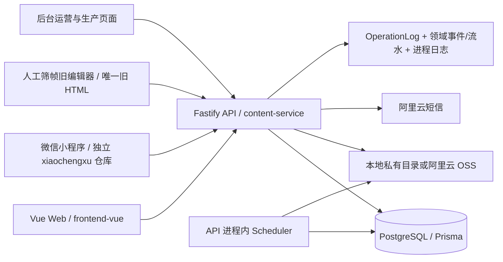

# ARCHITECTURE_CURRENT_STATE.md - 当前真实架构

> 调查日期：2026-10-16
> 收口日期：2026-10-19
> 主仓库基线：`b707536408a1ae0c2e383262f3c3e2a80bee206b`
> 小程序仓库基线：`097d35ff04580f394ce3f71fc7b3e447568dc391`
> 状态：RP1 全域入口和依赖调查完成；订单域仅记录入口和依赖，最终业务正确性等待负责人正在进行的订单改动稳定后补审。
> 方法：只读核查两个 Git 仓库的入口、路由、API、Prisma、文件存储、后台任务和日志；未修改业务代码、数据库或对象存储。

## 1. 架构结论

当前项目是“两个前端仓库 + 一个模块化单体 API + PostgreSQL + 私有文件存储”的结构：

- 正式 Web 已由 Vue Router 统一承载；旧静态目录只保留后台人工筛帧编辑器。
- 后端仍是单个 Fastify 服务，不是微服务；业务按路由和少量 service/lib 分层，但部分大路由混合协议、业务、持久化和审计。
- 微信小程序是独立 Git 仓库，当前能浏览联名内容并使用购物车接口，但结算、订单、地址、定制上传和通知仍是占位，且会话续期与后端 Cookie 方案不兼容。
- 当前没有已验证的真实微信支付闭环；Web 在线结算受功能开关限制，小程序真实支付属于 C 阶段未来边界。
- 订单代码正由负责人单独修改。本文件只固定调查基线和消费者关系，不宣称订单状态、金额、支付或库存逻辑已经最终正确。

## 2. 仓库与正式入口

| 范围 | 正式入口 | 当前责任 | 版本关系 |
|---|---|---|---|
| 主仓库 | `frontend-vue/`、`content-service/`、`frontend/pages/customize-editor.html` | Web、后台、API、数据库模型、Scheduler、唯一旧编辑器 | 同一 Git commit 管理 |
| 小程序仓库 | 同级目录 `../xiaochengxu/` | 微信小程序客户端 | 独立 Git；主仓库未固定兼容 commit |
| 数据库 | Prisma Schema 与迁移 | 83 个模型及当前业务状态 | 易变数量只以 RP0 基线为准 |
| 文件 | 本地私有目录或阿里云 OSS | 上传、绑定、签名访问、延迟清理 | 由 `PrivateFile` 与业务对象共同表达生命周期 |

Vue 正式入口覆盖公共站点、联名展示、定制、购物车、结算、订单、账号和后台运营/生产页面。`frontend/pages/customize-editor.html` 仅由后台人工筛帧工作台交接使用；Vite 开发环境通过 `/mowo/frontend` 代理到静态服务，因此它仍是运行链路，不是普通历史文件。

小程序已注册 14 个业务页面。当前联名首页、作品详情、短信登录、个人页和购物车有实际调用；结算、订单列表/详情、地址列表/编辑、通知、定制上传/预览仍显示“开发中”。`manifest.json` 尚未具备正式 AppID 和发布配置。

## 3. 服务端分层与外部依赖

`content-service/src/index.js` 完成配置、Fastify 插件、鉴权/岗位权限、安全审计 Hook、业务路由和进程内 Scheduler 注册。路由层直接使用 Prisma 的情况较多，真正独立的领域服务集中在文件清理、账号注销、选配、结算快照和部分生产能力。

| 依赖 | 当前用途 | 运行事实 |
|---|---|---|
| PostgreSQL + Prisma | 用户、商品、定制、订单、库存、生产、文件元数据、审计 | 核心事实来源；日常库只读，自动测试使用隔离库 |
| 本地私有存储 / 阿里云 OSS | 原素材、帧图、附件、生产文件 | 通过环境选择；长期生命周期仍需 RP5 核查 |
| 阿里云短信 | 验证码 | 由服务端发送；正式配额、告警和滥用防护待 RP6/RP7 |
| 支付 | 测试模拟与未来真实支付边界 | 真实回调验签尚未形成可发布证据，生产在线结算被强制关闭 |
| 微信平台 | 未来登录、手机号、支付、订阅通知 | 当前小程序未形成完整微信身份和支付实现 |

## 4. 领域边界

| 领域 | 当前主入口 | 主要事实源 | 当前状态 |
|---|---|---|---|
| 认证与账号 | Vue 登录/设置、后台用户；小程序短信登录 | `User`、`UserProfile`、会话/验证码/注销/审计表 | Web v1 为正式接口；旧资料接口仍可达；小程序续期不兼容 |
| 联名货架 | Vue 首页/联名页/详情/后台；小程序首页/详情 | 联名作品、销售 SKU、机器型号、动画资产/帧包 | 首发保留；线上创作者审核、合同、分红已退役 |
| 定制与动画 | Vue 定制链路、我的定制/动画、后台工作台、旧编辑器 | 请求、事件、商品草稿、动画资产/版本、筛帧选择、私有文件 | 双路线存在；状态、DTO 和清理有已登记 P1 |
| 交易 | Vue 购物车/结算/订单/后台订单；小程序购物车 | Cart、PreOrder、SalesOrder、SalesOrderItem、库存 | 入口已定位；最终正确性受订单在途改动阻塞 |
| 库存与材料 | 后台库存、机器型号、材料包 | SKU 库存、材料/批次、分装、退回、流水 | 首发保留；RP2/RP4/RP5 继续核对状态与约束 |
| 生产履约 | 后台订单、批次、扫码、打印 | 生产批次/单件、帧/打印文件、领料、配对、装箱、物流 | 首发保留；旧处理器仍留在 410 屏障之后 |
| 联络 | Vue 联络表单和后台留言 | ContactSubmission、PrivateFile、OperationLog | 首发保留 |
| 外部订单 | 后台受限占位入口 | 尚无正式导入模型/映射 | 只保留入口，写入关闭，不假设表格模板 |
| 社区/财务/牛量 | 无正式入口 | 旧运行实现已物理退役 | 当前版本不保留隐藏能力，未来重建 |

详细的调用者、数据和日志对应关系见 `RP1_CONSUMER_DATA_LOG_MATRIX.md`。

## 5. 运行、日志与管理脚本

- Scheduler 与 API 同进程启动；多实例会重复扫描，且没有统一租约、运行记录、readiness 或优雅停止。专项事实见 `RP1B_RUNTIME_JOBS_FACTS.md`。
- 全局安全审计 Hook 写入 `OperationLog`，并对密码、令牌、手机号、邮箱、地址、物流号和文件字段做脱敏；核心领域另有定制事件、库存流水、生产事件等事实记录。
- 日志存在不代表链路已可证明。请求 ID、外部调用、Scheduler 运行、告警和保留策略要在 RP7B 单独验收。
- `content-service/scripts/` 包含检查、回归和 backfill 工具。它们是维护消费者，不是线上 API；执行前必须区分只读检查、测试造数和数据修改脚本。

## 6. 当前边界与未来边界

当前首发代码应只服务联名商品、私人定制、混合购物车、订单、库存、生产履约和微信小程序支付交接。社区、线上分红、提现、牛量、线上创作者审核和合同不属于当前版本。

进入 C 阶段前仍必须完成：

1. 小程序可撤销、可轮换、可安全持久化的会话续期方案；
2. Web 到小程序的受控订单交接，及小程序结算、地址、订单和真实支付闭环；
3. 微信支付通知验签、幂等、金额核对、退款与异常补偿；
4. 主仓库与小程序兼容版本、共享契约和跨仓库门禁；
5. 正式 AppID、域名、隐私声明、预发/生产隔离和真机验收。

这些是未来发布门槛，不得因为页面或占位入口存在而写成“已实现”。

## 7. 已确认的结构性热点

1. 小程序刷新请求依赖 HttpOnly Cookie，但小程序请求层不能按浏览器方式自动维护该 Cookie。
2. 主仓库和小程序独立演进，没有兼容版本清单或跨仓库契约门禁。
3. 旧 `/api/auth/profile` 仍可达，并绕过 v1 资料接口的头像、昵称和生日规则。
4. 已退役订单/生产接口由全局 410 屏障拦截，但原处理器仍在路由文件中注册，形成永久双实现残留。
5. `admin.js` 与 `production-workflow.js` 跨越多个责任边界；是否拆分必须先补特征测试，不能只按行数重写。
6. 唯一旧编辑器使用独立页面和浏览器持久令牌，是明确的过渡信任边界；最终迁移或保留方案在 RP3/RP6 决定。
7. 定制请求与商品通过字符串 ID 而非数据库关系维持；动画版本对文件对象键的长期所有权仍需 RP5 验证。

对应证据和整改门槛见 `RP1_DEPENDENCY_HOTSPOTS.md` 与 `ENGINEERING_REVIEW_FINDINGS.md`。
